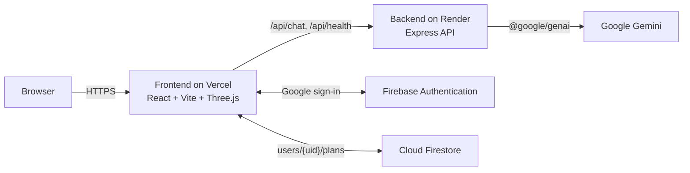

# NookSure AI

**A “Use What You Have” home safety planner for mobility needs.**

*Prepare thoughtfully. Reuse wisely.*

[](https://react.dev)
[](https://www.typescriptlang.org)
[](https://vite.dev)
[](https://threejs.org)
[](https://nodejs.org)
[](https://expressjs.com)
[](https://firebase.google.com)
[](https://ai.google.dev)
[](https://vercel.com)
[](https://render.com)

**Live demo:** https://nooksure-ai.vercel.app · **Demo video:** [YouTube link — coming soon](#)

> NookSure gives planning guidance only. It never certifies a home as safe and does not
> replace an occupational therapist, physiotherapist or qualified installer.

---

## Screenshots

| Landing page | Planner |
| --- | --- |
|  |  |
| **3D room view** | **AI assistant** |
|  |  |
| **Safety page** | |
|  | |

*Screenshots go in [`docs/screenshots/`](docs/screenshots/).*

---

## The problem

When someone who uses a walker or wheelchair, or is unsteady on their feet, comes home
or comes to stay, families often don’t know where to start. Generic advice jumps
straight to buying equipment. Worse, improvised fixes are risky: a towel rail used as a
grab bar, or bricks stacked into a ramp.

## The solution

NookSure turns what you notice in each room into an ordered checklist that uses what
you already have before suggesting anything new:

1. **Reuse:** put things you already own to safer use (lamps, baskets, shelves).
2. **Rearrange:** move furniture and everyday items to open routes and bring essentials within reach.
3. **Remove:** take away trip hazards such as loose rugs, clutter and trailing cables.
4. **Purchase:** only then, purpose-built products, properly installed where they bear weight.

The checklist comes from a reviewed rule set in `shared/` and is labelled as rule-based,
not AI analysis.

---

## Features

- **Home layout setup:** Studio / 1RK, 1BHK, 2BHK, 3BHK or a custom list of rooms, plus
  layout questions (front door into the living room, open kitchen, bathrooms, attached
  bathroom, balcony, garden and its steps). Rooms are generated from the answers, and
  merged spaces are shown as one room, e.g. “Living room + entrance + open kitchen”.
- **Furniture-aware plan:** pick the mobility aids, tick the furniture you already have
  and note what you see in each room. The plan gives advice about *your* sofa, rug or
  lamp first, in reuse → rearrange → remove → purchase order, and tracks progress.
- **Garden and outdoor areas:** paths, steps, gravel, moss, low branches and lighting.
- **Labelled 3D room view:** an interactive Three.js view of each room using real,
  credited furniture models (simple shapes where no model exists).
  - Issues are coloured by priority and marked with small **numbered pins**. A legend
    below the view holds the full text, and hovering or tapping a pin highlights its
    legend entry.
  - Toggleable **accessibility overlays**: a 1.5 m turning circle, the walking route
    from the door, grab bar zones (to be installed by a professional), non-slip zones
    and a night-light path.
  - Lazy-loaded, with a text fallback where WebGL isn’t available.
- **AI assistant (Google Gemini):** ask questions about preparing your home.
  - Calls run server-side only, so the key never reaches the browser.
  - Requests are validated, timed out and rate-limited, and messages describing an
    immediate hazard get a fixed “move away and contact emergency services” notice.
  - **Voice input** uses the browser’s speech recognition, and **read-aloud** uses its
    speech synthesis. Typing always works.
  - Without a key, it runs in a clearly labelled sample mode.
- **Saved plans with Google sign-in:** optional Firebase Authentication. Signed-in users
  can save, reopen and delete plans in Cloud Firestore, protected by owner-only security
  rules. Guest mode keeps your plan in the browser.
- **Safety page:** safety principles, room-by-room quick checks, a do/don’t list,
  when to call a professional, and a printable checklist.
- **Credits page:** attribution for every 3D model used.
- **Landing page:** a lazy-loaded 3D hero room, flip cards with examples, and a
  swipeable feature carousel.

---

## Tech stack

| Area | Technology |
| --- | --- |
| **Frontend** | React 18, TypeScript, Vite, Framer Motion |
| **3D** | Three.js, React Three Fiber, drei |
| **Backend** | Node.js (≥ 20), Express 4, TypeScript (run with `tsx`), Zod, CORS |
| **Shared** | `@nooksure/shared`: Zod schemas, types and the planner rule set (npm workspaces) |
| **AI** | Google Gemini via `@google/genai`, server-side only, behind an `AiProvider` adapter |
| **Auth / database** | Firebase Authentication (Google sign-in) and Cloud Firestore |
| **3D assets** | Poly Haven (CC0) and Sketchfab (CC BY 4.0) models, converted to `.glb` with Blender (`tools/blender/`) |
| **Testing** | Vitest, Testing Library (jsdom), Supertest |
| **Deployment** | Vercel (frontend), Render (backend) |

---

## Architecture



- The planner rules run in the browser (from `shared/`). Only the assistant talks to the backend.
- The Gemini key lives only on the backend. The browser receives only publishable
  `VITE_*` values (the Firebase web config and the API URL).
- More detail: [`docs/architecture.md`](docs/architecture.md).

---

## Project structure

```text
NookSure-AI-/
├── frontend/          React + Vite app (pages, 3D room view, landing, auth, assistant UI)
│   └── public/models/ Web-ready .glb furniture models used by the 3D views
├── backend/           Express API: /api/health and /api/chat (Gemini or labelled sample replies)
├── shared/            Zod schemas, types and the planner rule set, used by both apps
├── docs/              Setup, deploy, architecture and safety guides
├── tools/blender/     Scripts that convert downloaded 3D assets to verified .glb files
├── firestore.rules    Owner-only security rules for saved plans
├── render.yaml        Render Blueprint for the backend
├── vercel.json        Vercel build settings for the frontend
└── .env.example       Environment variable names (no values)
```

---

## Getting started

### Prerequisites

- **Node.js 20 or newer** (and npm)
- *Optional:* a [Gemini API key](https://aistudio.google.com) for live assistant replies
- *Optional:* a Firebase project with Google sign-in and Firestore for saved plans

### Install and run

```bash
git clone https://github.com/mokshadpoojary9-bot/NookSure-AI-.git
cd NookSure-AI-
npm install
cp .env.example .env        # Windows PowerShell: Copy-Item .env.example .env
```

Then, in two terminals:

```bash
npm run dev:backend         # http://localhost:3001/api/health
npm run dev:frontend        # http://localhost:5173
```

The app works with an empty `.env`: the assistant runs in labelled sample mode, and the
app runs as a guest with sign-in turned off. A full walkthrough is in
[`docs/setup.md`](docs/setup.md).

### Environment variables

Names only. Never commit `.env`, and never put the Gemini key in a `VITE_*` variable.

**Backend (server-only)**

| Variable | Purpose |
| --- | --- |
| `GEMINI_API_KEY` | Gemini key (secret). Empty → sample mode. |
| `GEMINI_MODEL` | Model to use (defaults to the SDK alias `gemini-flash-latest`; production uses `gemini-2.5-flash`). |
| `GEMINI_TIMEOUT_MS` | Optional request timeout (default 20000). |
| `CHAT_RATE_LIMIT_PER_MINUTE` | Optional chat rate limit (default 20). |
| `PORT` | Optional local port (default 3001; Render sets it automatically). |
| `CORS_ORIGIN` | Development CORS origin (default `http://localhost:5173`). |
| `FRONTEND_ORIGIN` | Production: comma-separated frontend URLs allowed by CORS. |
| `NODE_ENV` | Set to `production` on Render. |

**Frontend (publishable, bundled into the browser)**

| Variable | Purpose |
| --- | --- |
| `VITE_API_BASE_URL` | Backend URL (empty → `http://localhost:3001`). |
| `VITE_FIREBASE_API_KEY` | Firebase web config. |
| `VITE_FIREBASE_AUTH_DOMAIN` | Firebase web config. |
| `VITE_FIREBASE_PROJECT_ID` | Firebase web config. |
| `VITE_FIREBASE_STORAGE_BUCKET` | Firebase web config. |
| `VITE_FIREBASE_MESSAGING_SENDER_ID` | Firebase web config. |
| `VITE_FIREBASE_APP_ID` | Firebase web config. |
| `VITE_FIREBASE_MEASUREMENT_ID` | Optional (Analytics isn’t used yet). |

All `VITE_FIREBASE_*` values come from Firebase Console → Project settings → Your apps →
Web app. If they're empty, the app runs in guest mode.

### Scripts

| Command | What it does |
| --- | --- |
| `npm run dev:backend` | Backend with auto-reload (`tsx watch`) |
| `npm run dev:frontend` | Vite dev server |
| `npm test` | All test suites (shared, backend, frontend) |
| `npm run typecheck` | TypeScript checks in every workspace |
| `npm run build` | Production build of the frontend |
| `npm run check` | Typecheck + tests + build (run before every commit) |

---

## Deployment

The backend goes on **Render** and the frontend on **Vercel**, both from this repo.
Step-by-step guide: **[`docs/deploy.md`](docs/deploy.md)**.

1. **Render:** a web service from `render.yaml` (build `npm ci --include=dev`, start
   `npm run start -w backend`, health check `/api/health`). Set `GEMINI_API_KEY`,
   `GEMINI_MODEL=gemini-2.5-flash`, `NODE_ENV=production` and `NODE_VERSION=22`.
2. **Vercel:** import the repo (`vercel.json` sets the build). Set `VITE_API_BASE_URL`
   to the Render URL, plus the `VITE_FIREBASE_*` values.
3. **CORS:** set `FRONTEND_ORIGIN` on Render to the exact Vercel URL. In production, only
   these origins are allowed.
4. **Firebase:** add the Vercel domain under Authentication → Settings → **Authorized
   domains**, and publish [`firestore.rules`](firestore.rules).

---

## Safety and accessibility principles

- **Guidance, not a safety certificate.** NookSure never describes a home as “certified
  safe” or “fully accessible”.
- **No improvised load-bearing fixes.** It never suggests furniture, towel rails or sinks
  as grab bars, stacked objects as ramps or steps, or an ordinary stool as a shower seat.
- **Grab bars, handrails and ramps by professionals only.** Anything that bears weight or
  prevents falls points to a purpose-built product, correctly installed.
- **Honest AI labelling.** Every assistant reply carries `analysisMode` (`live` or
  `fixture`), and sample replies are visibly labelled.
- **Keyboard and screen-reader support.** Semantic headings and lists, visible focus,
  keyboard-operable flip cards, tabs and carousel, and a text alternative for the 3D room view (the hero room is decorative).
- **Reduced motion.** With `prefers-reduced-motion`, animations, the hero rotation and
  scroll effects are turned off.

The full rules are in [`docs/safety.md`](docs/safety.md).

---

## Testing

```bash
npm test          # or: npm run check (typecheck + tests + build)
```

Current result: **226 tests passing** (shared 48, backend 39, frontend 139).

Tests run without network access. Gemini, Firebase Auth, Firestore, the browser speech
APIs and WebGL are mocked, so they test the app’s own logic rather than the live services.

---

## Limitations

- **3D layouts are illustrative, not to scale.** Furniture positions are examples, not
  measurements of your home.
- **Render free-tier cold starts.** The backend sleeps after inactivity, so the first
  assistant request can take about 50 seconds while it wakes up.
- **No photo analysis yet.** The app works from what you tell it; it can’t see or inspect
  your home.
- Voice input depends on the browser’s speech recognition support (typing always works).

## Roadmap

- Room photo analysis
- Regional languages
- More 3D models
- A dedicated printable plan
- Connecting with local professionals (occupational therapists, installers)

---

## Credits

**3D models** (full list in the in-app Credits page and
[`models.manifest.json`](frontend/src/components/room3d/models.manifest.json)):

- **[Poly Haven](https://polyhaven.com)** (CC0): 41 models, including the sofa,
  armchairs, beds, tables, kitchen items, plants, garden bench and rocks.
- **Sketchfab** (CC BY 4.0):
  - [Toilet](https://sketchfab.com/3d-models/toilet-132a8ee2af3a40d39d270fbed3d3666c) by HippoStance
  - [Sink](https://sketchfab.com/3d-models/sink-29eae075fd384a03aa0e4cb06d9794df) by KIFIR
  - [Bathtub](https://sketchfab.com/3d-models/bathtub-3350f81025974c53808a2efd2b31d4fd) by 3ddominator
  - [Towel rail and towel](https://sketchfab.com/3d-models/towel-rail-and-towel-free-3a21870d7a88497a8ea3bb576f431c31) by AMMediaGames
  - [Towel stack](https://sketchfab.com/3d-models/towel-stack-56ebf3bf8cb445c9a743d3bf31e314bd) by matousekfoto
  - [Toilet paper holder](https://sketchfab.com/3d-models/toilet-paper-holder-12mb-a725f835410b418ab6be823f29caf2a6) by Mehdi Shahsavan
  - [Plastic bucket](https://sketchfab.com/3d-models/plastic-bucket-006d0f237b4141ac93960fa51d6f0634) by MaX3Dd
  - [Bed](https://sketchfab.com/3d-models/bed-b8c16d4b69f64335b46379b119b102b4) by rickmaolly
  - [Shower Cabin](https://sketchfab.com/3d-models/shower-cabin-e2c6a8dd490e4e4398378e1f6c9121a8) by Heliona

Built with help from [Claude Code](https://claude.com/claude-code).

## Author

**Moksha Poojary**: GitHub [@mokshadpoojary9-bot](https://github.com/mokshadpoojary9-bot)

## License

All rights reserved. No open-source license has been chosen yet.
